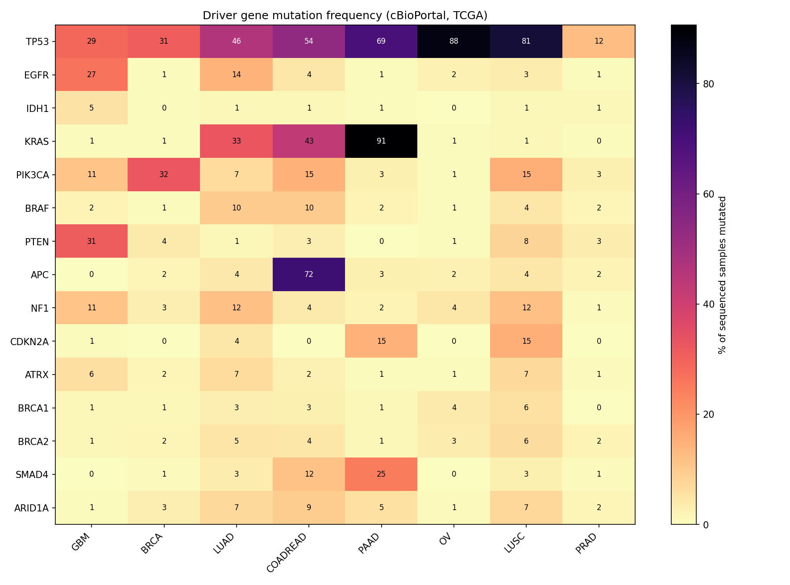
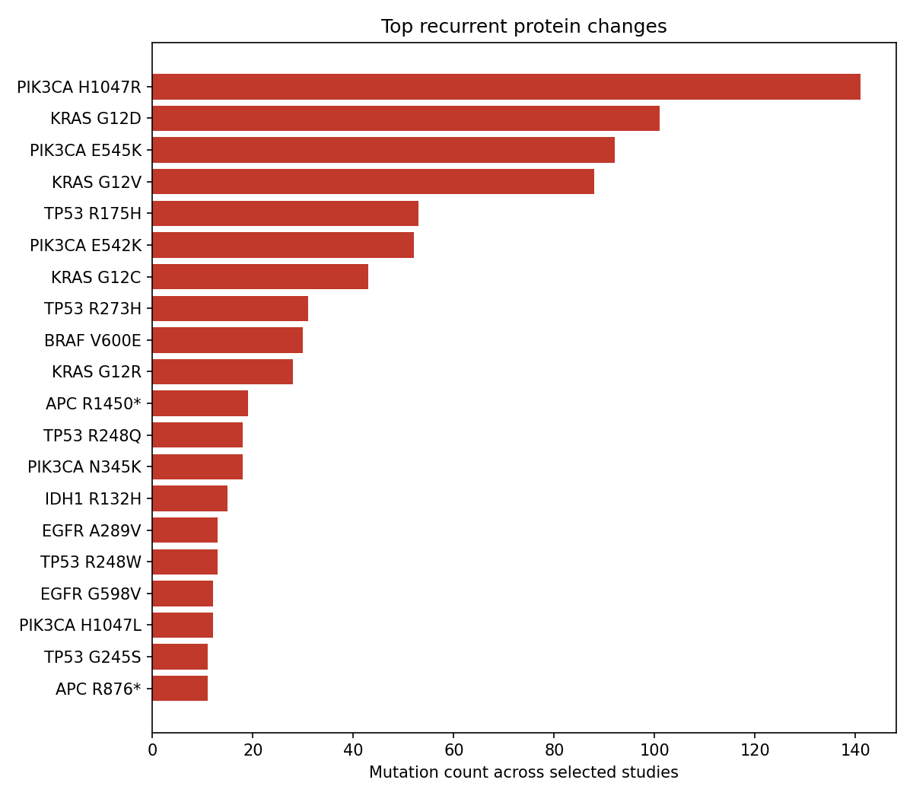

# Cancer Driver Mutation Report

Source: cBioPortal public API. Frequency = % of *sequenced* samples with >=1 mutation in the gene.
Research/education only, not medical advice.

## Summary: most frequently mutated gene per study

| Study | Sequenced samples | Top gene | Freq |
|---|---|---|---|
| Glioblastoma Multiforme (TCGA, Firehose Legacy) (`gbm_tcga`) | 290 | PTEN | 31.03% |
| Breast Invasive Carcinoma (TCGA, Firehose Legacy) (`brca_tcga`) | 982 | PIK3CA | 32.48% |
| Lung Adenocarcinoma (TCGA, Firehose Legacy) (`luad_tcga`) | 230 | TP53 | 46.09% |
| Colorectal Adenocarcinoma (TCGA, Firehose Legacy) (`coadread_tcga`) | 223 | APC | 71.75% |
| Pancreatic Adenocarcinoma (TCGA, Firehose Legacy) (`paad_tcga`) | 150 | KRAS | 90.67% |
| Ovarian Serous Cystadenocarcinoma (TCGA, Firehose Legacy) (`ov_tcga`) | 316 | TP53 | 87.66% |
| Lung Squamous Cell Carcinoma (TCGA, Firehose Legacy) (`lusc_tcga`) | 178 | TP53 | 81.46% |
| Prostate Adenocarcinoma (TCGA, Firehose Legacy) (`prad_tcga`) | 499 | TP53 | 12.22% |

## Frequency table (%)

| Gene | gbm_tcga | brca_tcga | luad_tcga | coadread_tcga | paad_tcga | ov_tcga | lusc_tcga | prad_tcga |
|---|---|---|---|---|---|---|---|---|
| TP53 | 28.97 | 30.65 | 46.09 | 53.81 | 69.33 | 87.66 | 81.46 | 12.22 |
| EGFR | 26.55 | 0.51 | 14.35 | 4.48 | 0.67 | 2.22 | 3.37 | 0.6 |
| IDH1 | 5.17 | 0.41 | 1.3 | 1.35 | 0.67 | 0.0 | 1.12 | 1.2 |
| KRAS | 0.69 | 0.61 | 32.61 | 43.05 | 90.67 | 0.63 | 1.12 | 0.4 |
| PIK3CA | 11.03 | 32.48 | 6.52 | 14.8 | 2.67 | 0.63 | 15.17 | 2.81 |
| BRAF | 2.07 | 0.51 | 9.57 | 9.87 | 2.0 | 0.63 | 4.49 | 1.6 |
| PTEN | 31.03 | 3.56 | 1.3 | 3.14 | 0.0 | 0.63 | 7.87 | 3.41 |
| APC | 0.34 | 1.63 | 3.91 | 71.75 | 2.67 | 2.22 | 4.49 | 2.0 |
| NF1 | 11.03 | 2.85 | 11.74 | 3.59 | 2.0 | 4.43 | 11.8 | 1.0 |
| CDKN2A | 0.69 | 0.2 | 4.35 | 0.0 | 14.67 | 0.0 | 15.17 | 0.2 |
| ATRX | 5.86 | 1.73 | 6.52 | 2.24 | 0.67 | 0.63 | 6.74 | 1.0 |
| BRCA1 | 1.38 | 1.32 | 3.04 | 2.69 | 1.33 | 3.8 | 5.62 | 0.2 |
| BRCA2 | 1.38 | 1.53 | 4.78 | 4.48 | 1.33 | 3.48 | 6.18 | 1.8 |
| SMAD4 | 0.34 | 0.71 | 3.48 | 11.66 | 24.67 | 0.0 | 2.81 | 1.0 |
| ARID1A | 0.69 | 2.85 | 6.96 | 9.42 | 5.33 | 0.95 | 7.3 | 1.6 |

## Glioblastoma Multiforme (TCGA, Firehose Legacy)
- Study ID `gbm_tcga`, 290 sequenced of 619 samples

- **PTEN**: 31.03% (90 samples, 93 mutations). Types: Missense_Mutation 50, Nonsense_Mutation 16, Frame_Shift_Del 16, Splice_Site 6, Frame_Shift_Ins 3, Splice_Region 1, In_Frame_Del 1. Top: R233* (5), R335* (3), R130* (3), T277I (2), T319* (2)
- **TP53**: 28.97% (84 samples, 101 mutations). Types: Missense_Mutation 81, Frame_Shift_Del 6, Splice_Site 6, Nonsense_Mutation 4, In_Frame_Del 2, Frame_Shift_Ins 1, Splice_Region 1. Top: R248Q (6), R175H (5), R282W (4), R273H (4), R158H (3)
- **EGFR**: 26.55% (77 samples, 95 mutations). Types: Missense_Mutation 90, In_Frame_Ins 3, Nonsense_Mutation 1, In_Frame_Del 1. Top: A289V (13), G598V (12), A289T (5), R222C (4), R108K (4)
- **PIK3CA**: 11.03% (32 samples, 35 mutations). Types: Missense_Mutation 26, In_Frame_Del 3, Translation_Start_Site 2, Splice_Site 1, Nonsense_Mutation 1, Nonstop_Mutation 1, Frame_Shift_Del 1. Top: E545K (4), M1043V (2), R88Q (2), M1? (2), H1047R (2)
- **NF1**: 11.03% (32 samples, 40 mutations). Types: Nonsense_Mutation 13, Frame_Shift_Del 10, Splice_Site 7, Missense_Mutation 6, Frame_Shift_Ins 3, In_Frame_Del 1. Top: R192* (2), K1661Gfs*36 (2), X196_splice (2), X1445_splice (1), L844F (1)
- **ATRX**: 5.86% (17 samples, 17 mutations). Types: Frame_Shift_Del 7, Missense_Mutation 5, Nonsense_Mutation 4, In_Frame_Del 1. Top: W2001Cfs*14 (1), E886Lfs*18 (1), L1827Cfs*9 (1), Q177* (1), K1424Gfs*65 (1)
- **IDH1**: 5.17% (15 samples, 15 mutations). Types: Missense_Mutation 15. Top: R132H (13), R132G (2)
- **BRAF**: 2.07% (6 samples, 6 mutations). Types: Missense_Mutation 6. Top: V600E (5), G596D (1)
- **BRCA1**: 1.38% (4 samples, 4 mutations). Types: Missense_Mutation 4. Top: P982L (1), R1203Q (1), A622V (1), R979H (1)
- **BRCA2**: 1.38% (4 samples, 4 mutations). Types: Missense_Mutation 4. Top: A2698T (1), D224V (1), H1752N (1), H1966R (1)
- **KRAS**: 0.69% (2 samples, 2 mutations). Types: Missense_Mutation 2. Top: G12D (2)
- **CDKN2A**: 0.69% (2 samples, 2 mutations). Types: Frame_Shift_Del 1, Nonsense_Mutation 1. Top: L78Hfs*41 (1), W110* (1)
- **ARID1A**: 0.69% (2 samples, 2 mutations). Types: Missense_Mutation 2. Top: S1929R (1), M918V (1)
- **APC**: 0.34% (1 samples, 1 mutations). Types: Missense_Mutation 1. Top: S1434G (1)
- **SMAD4**: 0.34% (1 samples, 1 mutations). Types: Missense_Mutation 1. Top: P544S (1)

## Breast Invasive Carcinoma (TCGA, Firehose Legacy)
- Study ID `brca_tcga`, 982 sequenced of 1108 samples

- **PIK3CA**: 32.48% (319 samples, 355 mutations). Types: Missense_Mutation 347, In_Frame_Del 4, Frame_Shift_Ins 2, In_Frame_Ins 1, Splice_Region 1. Top: H1047R (128), E545K (63), E542K (41), N345K (16), H1047L (12)
- **TP53**: 30.65% (301 samples, 304 mutations). Types: Missense_Mutation 179, Nonsense_Mutation 45, Frame_Shift_Del 41, Splice_Site 20, Frame_Shift_Ins 13, In_Frame_Del 5, Splice_Region 1. Top: R175H (18), R273H (10), R196* (9), R342* (7), H193R (7)
- **PTEN**: 3.56% (35 samples, 37 mutations). Types: Missense_Mutation 15, Frame_Shift_Del 7, Nonsense_Mutation 7, Frame_Shift_Ins 5, Splice_Site 2, In_Frame_Del 1. Top: N48Tfs*6 (2), S287* (2), V166Sfs*14 (1), H64_Y65del (1), E73Kfs*4 (1)
- **NF1**: 2.85% (28 samples, 30 mutations). Types: Missense_Mutation 10, Nonsense_Mutation 8, Splice_Site 5, Frame_Shift_Del 5, In_Frame_Del 1, Frame_Shift_Ins 1. Top: Q347* (2), W571* (1), R366* (1), E524Q (1), V54F (1)
- **ARID1A**: 2.85% (28 samples, 29 mutations). Types: Missense_Mutation 11, Nonsense_Mutation 10, Frame_Shift_Del 5, Frame_Shift_Ins 2, In_Frame_Del 1. Top: Q528* (3), R2143C (1), Q479* (1), S536P (1), Q944* (1)
- **ATRX**: 1.73% (17 samples, 22 mutations). Types: Missense_Mutation 18, Frame_Shift_Del 2, Nonsense_Mutation 1, In_Frame_Del 1. Top: D139Mfs*14 (1), R2028P (1), D896H (1), R840Nfs*8 (1), D1247H (1)
- **APC**: 1.63% (16 samples, 24 mutations). Types: Missense_Mutation 18, Frame_Shift_Del 4, Nonsense_Mutation 2. Top: E425Vfs*28 (1), V312G (1), E1726Q (1), D2817H (1), E109* (1)
- **BRCA2**: 1.53% (15 samples, 17 mutations). Types: Missense_Mutation 13, Nonsense_Mutation 1, In_Frame_Del 1, Splice_Site 1, Frame_Shift_Del 1. Top: L2926* (1), Y3049S (1), D1355Y (1), V1270del (1), X2602_splice (1)
- **BRCA1**: 1.32% (13 samples, 13 mutations). Types: Missense_Mutation 8, Nonsense_Mutation 2, In_Frame_Del 1, Splice_Site 1, Frame_Shift_Del 1. Top: E9Q (1), E720* (1), K50T (1), G1788V (1), C644del (1)
- **SMAD4**: 0.71% (7 samples, 7 mutations). Types: Missense_Mutation 3, Frame_Shift_Del 2, Nonsense_Mutation 2. Top: L109R (1), N316Ifs*20 (1), G231Afs*10 (1), H132Y (1), R361H (1)
- **KRAS**: 0.61% (6 samples, 6 mutations). Types: Missense_Mutation 6. Top: G12V (3), D92Y (1), G12C (1), G12D (1)
- **EGFR**: 0.51% (5 samples, 5 mutations). Types: Missense_Mutation 5. Top: E114K (2), D314G (1), D1051N (1), T273A (1)
- **BRAF**: 0.51% (5 samples, 5 mutations). Types: Missense_Mutation 4, Nonsense_Mutation 1. Top: D449N (1), K698R (1), E309* (1), E433K (1), L537S (1)
- **IDH1**: 0.41% (4 samples, 5 mutations). Types: Missense_Mutation 5. Top: R338T (1), K81N (1), Y235C (1), R132C (1), A179D (1)
- **CDKN2A**: 0.2% (2 samples, 2 mutations). Types: Frame_Shift_Ins 1, Frame_Shift_Del 1. Top: T137Hfs*5 (1), T79Pfs*40 (1)

## Lung Adenocarcinoma (TCGA, Firehose Legacy)
- Study ID `luad_tcga`, 230 sequenced of 586 samples

- **TP53**: 46.09% (106 samples, 115 mutations). Types: Missense_Mutation 73, Nonsense_Mutation 21, Frame_Shift_Del 11, Splice_Site 5, Splice_Region 3, Frame_Shift_Ins 1, In_Frame_Del 1. Top: R175H (3), T125= (3), A159P (3), V73Wfs*50 (3), R158L (3)
- **KRAS**: 32.61% (75 samples, 76 mutations). Types: Missense_Mutation 75, Nonsense_Mutation 1. Top: G12C (36), G12V (20), G12A (6), G12D (5), G12S (2)
- **EGFR**: 14.35% (33 samples, 45 mutations). Types: Missense_Mutation 30, In_Frame_Del 12, In_Frame_Ins 1, Nonsense_Mutation 1, Frame_Shift_Del 1. Top: L858R (8), E746_A750del (6), L861Q (3), S768I (2), E709_T710delinsD (2)
- **NF1**: 11.74% (27 samples, 31 mutations). Types: Missense_Mutation 11, Frame_Shift_Del 8, Nonsense_Mutation 7, Splice_Site 3, Frame_Shift_Ins 1, Splice_Region 1. Top: E2357* (1), Q1815L (1), F1275Pfs*8 (1), G1668V (1), X1938_splice (1)
- **BRAF**: 9.57% (22 samples, 23 mutations). Types: Missense_Mutation 20, Splice_Site 2, Nonsense_Mutation 1. Top: V600E (5), G469V (3), G466V (2), N581S (2), A762E (1)
- **ARID1A**: 6.96% (16 samples, 17 mutations). Types: Nonsense_Mutation 9, Missense_Mutation 7, Frame_Shift_Del 1. Top: E1760* (1), Q435* (1), Q754* (1), Q1357L (1), E2032K (1)
- **PIK3CA**: 6.52% (15 samples, 15 mutations). Types: Missense_Mutation 15. Top: E545K (5), E542K (3), H1047R (1), E600K (1), R87T (1)
- **ATRX**: 6.52% (15 samples, 15 mutations). Types: Missense_Mutation 11, Nonsense_Mutation 4. Top: R81M (1), N1753D (1), S677* (1), G1945E (1), E1223Q (1)
- **BRCA2**: 4.78% (11 samples, 11 mutations). Types: Missense_Mutation 9, Nonsense_Mutation 2. Top: I2718V (1), S3376* (1), P2608S (1), R1512H (1), E3403Q (1)
- **CDKN2A**: 4.35% (10 samples, 10 mutations). Types: Missense_Mutation 6, Frame_Shift_Ins 2, Splice_Site 1, Frame_Shift_Del 1. Top: X51_splice (1), H83Y (1), P167S (1), L94P (1), D84N (1)
- **APC**: 3.91% (9 samples, 9 mutations). Types: Missense_Mutation 5, Frame_Shift_Ins 1, Nonsense_Mutation 1, Frame_Shift_Del 1, Splice_Site 1. Top: D1562N (1), S1415Kfs*8 (1), A2313S (1), Q2291* (1), G2227Qfs*12 (1)
- **SMAD4**: 3.48% (8 samples, 8 mutations). Types: Missense_Mutation 5, Nonsense_Mutation 2, Splice_Region 1. Top: D493N (1), S242* (1), S144* (1), R361H (1), R100W (1)
- **BRCA1**: 3.04% (7 samples, 7 mutations). Types: Missense_Mutation 7. Top: V412L (1), G1350A (1), E1000Q (1), K175N (1), T1548M (1)
- **IDH1**: 1.3% (3 samples, 3 mutations). Types: Missense_Mutation 3. Top: R132L (1), R109K (1), D375Y (1)
- **PTEN**: 1.3% (3 samples, 3 mutations). Types: Missense_Mutation 2, Nonsense_Mutation 1. Top: M35I (1), H123Y (1), G36* (1)

## Colorectal Adenocarcinoma (TCGA, Firehose Legacy)
- Study ID `coadread_tcga`, 223 sequenced of 640 samples

- **APC**: 71.75% (160 samples, 241 mutations). Types: Nonsense_Mutation 166, Missense_Mutation 32, Frame_Shift_Del 31, Frame_Shift_Ins 11, Splice_Site 1. Top: R1450* (19), R876* (11), R216* (7), R805* (6), R564* (6)
- **TP53**: 53.81% (120 samples, 122 mutations). Types: Missense_Mutation 83, Nonsense_Mutation 21, Frame_Shift_Del 10, Frame_Shift_Ins 6, Splice_Region 1, In_Frame_Del 1. Top: R175H (14), R248W (8), R213* (7), R273H (7), G245S (4)
- **KRAS**: 43.05% (96 samples, 96 mutations). Types: Missense_Mutation 95, Nonsense_Mutation 1. Top: G12D (31), G12V (23), G13D (10), A146T (8), G12C (6)
- **PIK3CA**: 14.8% (33 samples, 40 mutations). Types: Missense_Mutation 40. Top: E545K (8), H1047R (5), R88Q (4), E542K (2), N345K (2)
- **SMAD4**: 11.66% (26 samples, 30 mutations). Types: Missense_Mutation 25, Nonsense_Mutation 3, Frame_Shift_Del 1, In_Frame_Del 1. Top: R361H (7), D355G (1), R97H (1), S357P (1), G510R (1)
- **BRAF**: 9.87% (22 samples, 23 mutations). Types: Missense_Mutation 23. Top: V600E (20), E228V (1), K205Q (1), F247L (1)
- **ARID1A**: 9.42% (21 samples, 22 mutations). Types: Nonsense_Mutation 10, Missense_Mutation 9, Frame_Shift_Ins 2, In_Frame_Del 1. Top: R1722* (2), R1989* (2), Q761Pfs*56 (1), G922D (1), R1262H (1)
- **EGFR**: 4.48% (10 samples, 11 mutations). Types: Missense_Mutation 11. Top: N842H (1), S768T (1), P596L (1), R222C (1), R831H (1)
- **BRCA2**: 4.48% (10 samples, 22 mutations). Types: Missense_Mutation 19, Nonsense_Mutation 2, Frame_Shift_Del 1. Top: R3052W (1), F2568C (1), S1650Vfs*20 (1), E832G (1), I332M (1)
- **NF1**: 3.59% (8 samples, 11 mutations). Types: Missense_Mutation 7, Nonsense_Mutation 4. Top: R2450* (1), E524* (1), R1276Q (1), F2544V (1), K1379T (1)
- **PTEN**: 3.14% (7 samples, 11 mutations). Types: Missense_Mutation 6, Nonsense_Mutation 4, Frame_Shift_Del 1. Top: R130Q (3), A126Lfs*8 (1), R130* (1), R233* (1), E299* (1)
- **BRCA1**: 2.69% (6 samples, 6 mutations). Types: Missense_Mutation 5, Nonsense_Mutation 1. Top: E489G (1), E907K (1), S1503* (1), R170Q (1), D821Y (1)
- **ATRX**: 2.24% (5 samples, 8 mutations). Types: Missense_Mutation 8. Top: A771V (1), A2137T (1), L1612I (1), K987N (1), K1583N (1)
- **IDH1**: 1.35% (3 samples, 3 mutations). Types: Missense_Mutation 3. Top: R132C (1), M182L (1), P33S (1)

## Pancreatic Adenocarcinoma (TCGA, Firehose Legacy)
- Study ID `paad_tcga`, 150 sequenced of 186 samples

- **KRAS**: 90.67% (136 samples, 140 mutations). Types: Missense_Mutation 140. Top: G12D (61), G12V (40), G12R (27), Q61H (6), Q61R (2)
- **TP53**: 69.33% (104 samples, 105 mutations). Types: Missense_Mutation 72, Nonsense_Mutation 17, Frame_Shift_Del 7, Frame_Shift_Ins 4, Splice_Site 4, In_Frame_Ins 1. Top: R175H (5), R248W (5), R282W (3), G245S (3), R273C (3)
- **SMAD4**: 24.67% (37 samples, 38 mutations). Types: Missense_Mutation 16, Nonsense_Mutation 11, Frame_Shift_Del 8, Frame_Shift_Ins 2, In_Frame_Del 1. Top: R361C (3), E520* (2), G352* (2), S227Vfs*14 (1), Q289* (1)
- **CDKN2A**: 14.67% (22 samples, 22 mutations). Types: Nonsense_Mutation 10, Missense_Mutation 6, Frame_Shift_Del 3, Frame_Shift_Ins 2, In_Frame_Del 1. Top: R80* (6), H83Y (4), R58* (2), E120* (1), L97_H98del (1)
- **ARID1A**: 5.33% (8 samples, 12 mutations). Types: Nonsense_Mutation 6, Missense_Mutation 3, Frame_Shift_Del 2, Splice_Site 1. Top: E1542* (1), R1276* (1), X1239_splice (1), Q1947* (1), Q594Sfs*25 (1)
- **PIK3CA**: 2.67% (4 samples, 4 mutations). Types: Missense_Mutation 4. Top: P539R (1), R979G (1), M1010T (1), M1043L (1)
- **APC**: 2.67% (4 samples, 7 mutations). Types: Missense_Mutation 7. Top: D1825G (1), S1252Y (1), A597T (1), R374W (1), Y158H (1)
- **BRAF**: 2.0% (3 samples, 3 mutations). Types: In_Frame_Del 2, Missense_Mutation 1. Top: R462T (1), N486_P490del (1), T488_Q493delinsK (1)
- **NF1**: 2.0% (3 samples, 4 mutations). Types: Nonsense_Mutation 2, Missense_Mutation 2. Top: Q1070* (1), R1958C (1), T1972A (1), Q1617* (1)
- **BRCA1**: 1.33% (2 samples, 3 mutations). Types: Missense_Mutation 3. Top: A314T (1), V1590A (1), S646G (1)
- **BRCA2**: 1.33% (2 samples, 6 mutations). Types: Missense_Mutation 5, Frame_Shift_Del 1. Top: V2716Wfs*17 (1), I1017F (1), T1346N (1), N1642T (1), V2079M (1)
- **EGFR**: 0.67% (1 samples, 3 mutations). Types: Missense_Mutation 2, Nonsense_Mutation 1. Top: D800G (1), L683M (1), R669* (1)
- **IDH1**: 0.67% (1 samples, 1 mutations). Types: Missense_Mutation 1. Top: R49C (1)
- **ATRX**: 0.67% (1 samples, 1 mutations). Types: Missense_Mutation 1. Top: S598F (1)

## Ovarian Serous Cystadenocarcinoma (TCGA, Firehose Legacy)
- Study ID `ov_tcga`, 316 sequenced of 617 samples

- **TP53**: 87.66% (277 samples, 280 mutations). Types: Missense_Mutation 179, Splice_Site 33, Nonsense_Mutation 27, Frame_Shift_Del 23, Frame_Shift_Ins 9, In_Frame_Del 5, Splice_Region 3, In_Frame_Ins 1. Top: R273H (10), X187_splice (8), R248Q (8), Y220C (8), R175H (8)
- **NF1**: 4.43% (14 samples, 15 mutations). Types: Missense_Mutation 6, Nonsense_Mutation 4, Frame_Shift_Del 3, Splice_Site 1, Frame_Shift_Ins 1. Top: K1444E (1), Q112* (1), L550P (1), L194P (1), G1863A (1)
- **BRCA1**: 3.8% (12 samples, 12 mutations). Types: Frame_Shift_Del 5, Nonsense_Mutation 4, Frame_Shift_Ins 2, Missense_Mutation 1. Top: Q1538* (1), R1835* (1), C47W (1), C24Sfs*16 (1), N1265Kfs*4 (1)
- **BRCA2**: 3.48% (11 samples, 12 mutations). Types: Frame_Shift_Del 6, Nonsense_Mutation 4, Missense_Mutation 2. Top: C711* (1), S1882* (1), R2394* (1), K1406Nfs*3 (1), E1407Vfs*5 (1)
- **EGFR**: 2.22% (7 samples, 7 mutations). Types: Missense_Mutation 6, Frame_Shift_Del 1. Top: A839V (1), E709Q (1), P772R (1), S380Pfs*16 (1), Q1164R (1)
- **APC**: 2.22% (7 samples, 8 mutations). Types: Missense_Mutation 7, Nonsense_Mutation 1. Top: E1286G (1), W593L (1), L852S (1), G1120E (1), S2005* (1)
- **ARID1A**: 0.95% (3 samples, 3 mutations). Types: Nonsense_Mutation 2, Missense_Mutation 1. Top: G856V (1), S664* (1), Q1708* (1)
- **KRAS**: 0.63% (2 samples, 2 mutations). Types: Missense_Mutation 2. Top: G12V (2)
- **PIK3CA**: 0.63% (2 samples, 2 mutations). Types: Missense_Mutation 2. Top: E545K (1), H1047R (1)
- **BRAF**: 0.63% (2 samples, 2 mutations). Types: Nonsense_Mutation 1, Missense_Mutation 1. Top: S637* (1), N581S (1)
- **PTEN**: 0.63% (2 samples, 2 mutations). Types: Missense_Mutation 1, Frame_Shift_Del 1. Top: V175L (1), R233Dfs*23 (1)
- **ATRX**: 0.63% (2 samples, 2 mutations). Types: Frame_Shift_Del 1, Missense_Mutation 1. Top: S1326Qfs*20 (1), N2290S (1)

## Lung Squamous Cell Carcinoma (TCGA, Firehose Legacy)
- Study ID `lusc_tcga`, 178 sequenced of 511 samples

- **TP53**: 81.46% (145 samples, 152 mutations). Types: Missense_Mutation 100, Nonsense_Mutation 20, Frame_Shift_Del 12, Splice_Site 10, Splice_Region 5, In_Frame_Del 2, Frame_Shift_Ins 2, In_Frame_Ins 1. Top: R158L (5), C242F (3), E298* (3), R273L (3), T125= (3)
- **PIK3CA**: 15.17% (27 samples, 29 mutations). Types: Missense_Mutation 29. Top: E545K (10), E542K (3), E726K (2), H1047R (2), C420R (1)
- **CDKN2A**: 15.17% (27 samples, 27 mutations). Types: Missense_Mutation 15, Nonsense_Mutation 9, Frame_Shift_Del 3. Top: D108Y (3), W110* (2), V115Wfs*31 (1), D108G (1), E119* (1)
- **NF1**: 11.8% (21 samples, 22 mutations). Types: Missense_Mutation 15, Nonsense_Mutation 5, Splice_Site 2. Top: D2632V (1), Q181H (1), M1981V (1), C904* (1), S82C (1)
- **PTEN**: 7.87% (14 samples, 16 mutations). Types: Missense_Mutation 8, Nonsense_Mutation 6, Frame_Shift_Del 2. Top: Q245* (2), K128Q (1), E235* (1), A328Qfs*16 (1), L320* (1)
- **ARID1A**: 7.3% (13 samples, 15 mutations). Types: Missense_Mutation 8, Frame_Shift_Del 3, Frame_Shift_Ins 1, Nonsense_Mutation 1, Splice_Region 1, Splice_Site 1. Top: P431Q (1), S2104F (1), Q449Hfs*171 (1), L1049V (1), Q2070H (1)
- **ATRX**: 6.74% (12 samples, 14 mutations). Types: Missense_Mutation 12, Splice_Region 1, Nonsense_Mutation 1. Top: L1612V (1), K686N (1), A1064T (1), E1315= (1), G1964A (1)
- **BRCA2**: 6.18% (11 samples, 12 mutations). Types: Missense_Mutation 9, Nonsense_Mutation 2, Splice_Site 1. Top: S2201F (1), X2659_splice (1), V2820I (1), S2098T (1), Q499* (1)
- **BRCA1**: 5.62% (10 samples, 12 mutations). Types: Missense_Mutation 9, Nonsense_Mutation 2, Splice_Site 1. Top: V525A (1), Q94* (1), R320T (1), V1665L (1), D1344N (1)
- **BRAF**: 4.49% (8 samples, 8 mutations). Types: Missense_Mutation 7, Splice_Site 1. Top: G469R (1), G466V (1), D380H (1), X621_splice (1), R95T (1)
- **APC**: 4.49% (8 samples, 9 mutations). Types: Missense_Mutation 7, Nonsense_Mutation 2. Top: L1393I (1), S320* (1), P1381S (1), S966G (1), Q2403H (1)
- **EGFR**: 3.37% (6 samples, 7 mutations). Types: Missense_Mutation 6, Splice_Site 1. Top: L861Q (2), P1019L (1), P589L (1), X210_splice (1), S720C (1)
- **SMAD4**: 2.81% (5 samples, 5 mutations). Types: Nonsense_Mutation 3, Missense_Mutation 2. Top: D537E (1), E526* (1), Q289* (1), S204Y (1), Q183* (1)
- **IDH1**: 1.12% (2 samples, 2 mutations). Types: Missense_Mutation 2. Top: G221V (1), L359F (1)
- **KRAS**: 1.12% (2 samples, 2 mutations). Types: Missense_Mutation 2. Top: C118S (1), Q61H (1)

## Prostate Adenocarcinoma (TCGA, Firehose Legacy)
- Study ID `prad_tcga`, 499 sequenced of 501 samples

- **TP53**: 12.22% (61 samples, 64 mutations). Types: Missense_Mutation 46, Frame_Shift_Del 8, Splice_Site 6, Frame_Shift_Ins 2, Nonsense_Mutation 2. Top: G245S (4), R248Q (4), Y163H (3), X126_splice (3), G245D (3)
- **PTEN**: 3.41% (17 samples, 17 mutations). Types: Missense_Mutation 5, Frame_Shift_Ins 5, Frame_Shift_Del 4, Splice_Site 1, In_Frame_Del 1, Nonsense_Mutation 1. Top: T319Ffs*5 (1), V119F (1), D326G (1), X70_splice (1), N323Kfs*2 (1)
- **PIK3CA**: 2.81% (14 samples, 16 mutations). Types: Missense_Mutation 16. Top: E542K (3), H1047R (2), C420R (1), E545K (1), R88Q (1)
- **APC**: 2.0% (10 samples, 10 mutations). Types: Nonsense_Mutation 6, Missense_Mutation 2, Frame_Shift_Ins 1, Frame_Shift_Del 1. Top: S1539* (1), Q1123* (1), T1438Nfs*17 (1), R2714H (1), A1553V (1)
- **BRCA2**: 1.8% (9 samples, 9 mutations). Types: Missense_Mutation 4, Frame_Shift_Del 3, Frame_Shift_Ins 2. Top: N433Tfs*27 (1), N1435T (1), V726Sfs*25 (1), S3364Ifs*4 (1), D281H (1)
- **BRAF**: 1.6% (8 samples, 8 mutations). Types: Missense_Mutation 7, In_Frame_Del 1. Top: G469A (2), G258V (1), K601_W604del (1), L597R (1), T401A (1)
- **ARID1A**: 1.6% (8 samples, 8 mutations). Types: Missense_Mutation 4, In_Frame_Ins 2, Nonsense_Mutation 1, In_Frame_Del 1. Top: Q708* (1), A167dup (1), G191del (1), P1756R (1), R1551H (1)
- **IDH1**: 1.2% (6 samples, 6 mutations). Types: Missense_Mutation 6. Top: R132H (2), R132C (2), R132G (1), E306D (1)
- **NF1**: 1.0% (5 samples, 5 mutations). Types: Missense_Mutation 3, Frame_Shift_Del 2. Top: F150Sfs*15 (2), H415Y (1), R2713W (1), K2044E (1)
- **ATRX**: 1.0% (5 samples, 5 mutations). Types: Missense_Mutation 4, Frame_Shift_Del 1. Top: C220W (1), M1556T (1), I2050S (1), S598Rfs*3 (1), M1920I (1)
- **SMAD4**: 1.0% (5 samples, 7 mutations). Types: Missense_Mutation 7. Top: S504R (1), Y353N (1), D351Y (1), D355V (1), D493N (1)
- **EGFR**: 0.6% (3 samples, 3 mutations). Types: Missense_Mutation 3. Top: G1185V (1), G312W (1), F997V (1)
- **KRAS**: 0.4% (2 samples, 2 mutations). Types: Missense_Mutation 2. Top: G12R (1), G12D (1)
- **CDKN2A**: 0.2% (1 samples, 1 mutations). Types: Nonsense_Mutation 1. Top: R80* (1)
- **BRCA1**: 0.2% (1 samples, 1 mutations). Types: Missense_Mutation 1. Top: E181D (1)
